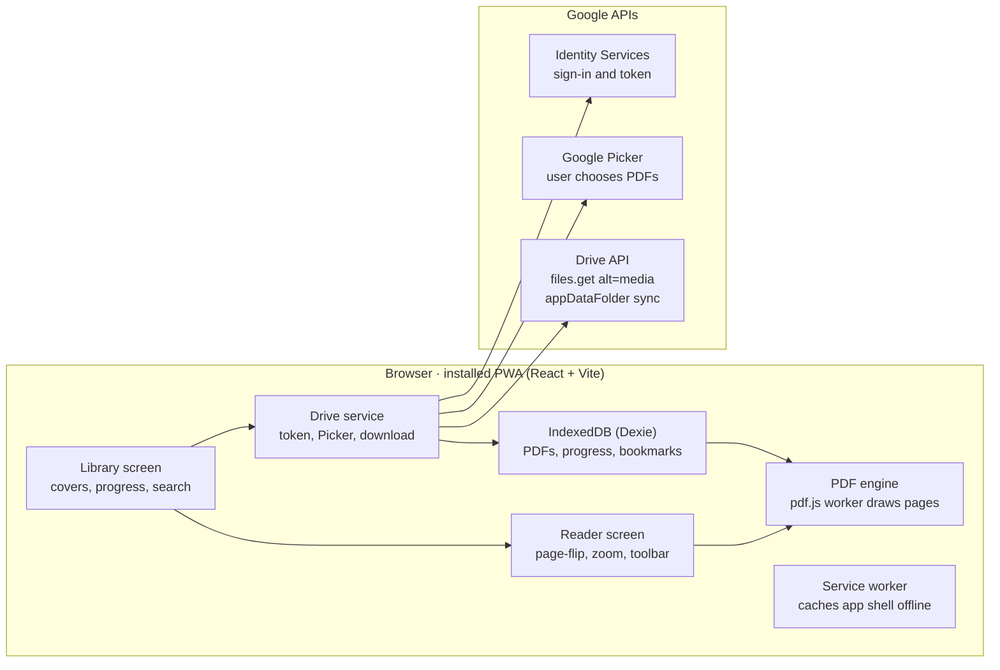

# PRD: PageTurn — PDF Flipbook Reader with Google Drive

*As of 2026-11-16*

## Overview

PageTurn is an installable web app (PWA) that opens PDFs from Google Drive or the device and shows them as a book: two-page spreads on wide screens, single pages on phones, with pages you swipe, drag or click to turn. It remembers where you stopped in every book.

This PRD is the build spec for Claude Code.

### Problem

Students read long PDFs: textbooks, lecture notes, papers. Phone and browser PDF viewers scroll one endless strip. You lose your place, can't see a spread, and moving files from Drive to a reader app is tedious.

### Goals (v1)

1. Open any PDF from Google Drive, or from the device, in 3 taps or fewer.
2. Read it as a book, with a realistic page turn by swipe, drag, click, or keyboard.
3. Reopen any book at the last page read, on the same device, with no extra steps.
4. Stay smooth: first page visible in under 2 seconds for a typical 300-page textbook on a mid-range phone.
5. Cost nothing to run: static hosting, no backend server, no database.

### Non-goals (v1)

- Editing PDFs, annotation and highlighting (planned for v2).
- Converting to EPUB or other formats. "Book format" here means the reading experience, not a new file.
- Native iOS or Android apps. The PWA installs to the home screen instead.
- Sharing, social features or accounts of our own. Google sign-in is the only identity.
- Uploading or writing files back to Drive.

## Users and user stories

The primary user is a university or high-school student who keeps course material in Google Drive and reads it on a phone, tablet and laptop.

| Persona | Device | Main need |
| --- | --- | --- |
| Commuter reader | Phone, portrait | One-handed swipe through lecture notes on the bus |
| Textbook studier | Tablet or laptop, landscape | Two-page spreads, jump to chapter, resume later |
| Exam crammer | Any | Find a page fast, see thumbnails, read offline |

**User stories** (each maps to requirements in the next section):

1. As a student, I sign in with Google and pick a PDF from my Drive, so I don't have to download it first.
2. As a student, I can also open a PDF from my device, so I can read files that aren't in Drive.
3. As a reader, I swipe or drag a page corner to turn it, so reading feels like a real book.
4. As a reader, I see two pages side by side on a wide screen and one page on a narrow screen.
5. As a reader, I reopen a book and land on the page where I stopped.
6. As a reader, I jump to a page number, a chapter from the PDF outline, or a thumbnail.
7. As a reader, I zoom into a page to read small print or diagrams, without accidentally turning the page.
8. As a reader, I keep reading books I opened before when I have no internet.
9. As a reader, I bookmark pages and switch to a dark or sepia theme for night study.

## Functional requirements

P0 ships in the MVP; P1 completes v1; P2 is nice-to-have. IDs are referenced by the build phases and tests.

### Google Drive and file import

| ID | Requirement | Priority |
| --- | --- | --- |
| DRV-1 | Sign in with Google using Google Identity Services (token model, in the browser). Show the signed-in name and avatar, and a Sign out action. | P0 |
| DRV-2 | "Open from Drive" launches the Google Picker filtered to `application/pdf`, with My Drive, Shared with me and Recent views. Multi-select allowed. | P0 |
| DRV-3 | Download picked files with Drive API `files.get?alt=media` using the `drive.file` scope only. Show a progress bar for files over 5 MB. | P0 |
| DRV-4 | When the access token expires, refresh it silently on next Drive action; if that fails, prompt to sign in again without losing the open book. | P0 |
| DRV-5 | "Open from device" accepts a local PDF via file input and drag-and-drop onto the library. Works without signing in. | P0 |
| DRV-6 | On reopen, if the Drive file's `modifiedTime` changed, offer "A newer version is in Drive — update?" | P1 |
| DRV-7 | Reject non-PDF and password-protected PDFs with a clear message (password prompt is P2). | P0 |

### Library

| ID | Requirement | Priority |
| --- | --- | --- |
| LIB-1 | Grid of book covers (page 1 thumbnail), title, source icon (Drive or device), and progress bar ("p. 84 of 312 · 27%"). | P0 |
| LIB-2 | Sort by last opened (default), title, date added. Search by title. | P1 |
| LIB-3 | Remove a book from the library (deletes the local copy only, never the Drive file). Confirm first. | P0 |
| LIB-4 | Empty state explains the two ways to add a book. | P0 |
| LIB-5 | Shelves or folders to group books by course. | P2 |

### Flipbook reader

| ID | Requirement | Priority |
| --- | --- | --- |
| RDR-1 | Render PDF pages with pdf.js to canvas, then show them in a page-flip component with a curl animation and page shadow. | P0 |
| RDR-2 | Layout: two-page spread (cover alone on the right) when the viewport is landscape and at least 900 px wide; single page otherwise. Switches live on rotate or resize. User can override: Auto, Single, Spread. | P0 |
| RDR-3 | Turn pages by: swipe on touch, drag a corner with mouse or finger, tap or click the left/right 20% of the screen, Arrow keys, PageUp/PageDown, Space. | P0 |
| RDR-4 | Animation can be switched off ("Slide" or "None"), and is off by default when the OS asks for reduced motion. | P0 |
| RDR-5 | Pages render at device pixel ratio for sharp text; quality rises after the flip settles (low-res first, then crisp). | P0 |
| RDR-6 | Zoom: pinch, double-tap, Ctrl/Cmd + scroll, and +/− buttons, 100% to 400%. While zoomed, swipes pan the page and never turn it; a "Reset zoom" control appears. | P0 |
| RDR-7 | Toolbar (auto-hides after 3 s, tap centre to show): back to library, title, page indicator, outline, thumbnails, bookmarks, settings, fullscreen. | P0 |
| RDR-8 | Page scrubber: a slider at the bottom with a live page-number preview. | P1 |
| RDR-9 | Go to page: tap the page indicator, type a number. | P0 |
| RDR-10 | Outline panel from the PDF's table of contents, if it has one; tapping an entry jumps there. | P1 |
| RDR-11 | Thumbnails panel, lazily rendered, current page highlighted. | P1 |
| RDR-12 | Internal PDF links (e.g. "see page 40") jump to the target page; external links open in a new tab. | P1 |
| RDR-13 | Themes: Light, Sepia, Dark. Dark dims the page with a filter rather than inverting images. | P1 |
| RDR-14 | Bookmarks: toggle on the current page, list them in a panel. | P1 |
| RDR-15 | Text search inside the PDF, with results list and highlight. | P2 |
| RDR-16 | Page-turn sound, off by default. | P2 |

### Progress, offline and install

| ID | Requirement | Priority |
| --- | --- | --- |
| PRG-1 | Save the current page and last-opened time on every page turn (debounced 500 ms) to IndexedDB. Reopening a book lands on that page. | P0 |
| PRG-2 | Sync progress and bookmarks across devices in the Drive appDataFolder (`drive.appdata` scope), last-write-wins per book. | P1 |
| OFF-1 | Cache each opened PDF in IndexedDB so books open with no network. Show total storage used and a "Clear cache" option in settings. | P0 |
| OFF-2 | Service worker caches the app shell so the app itself loads offline. | P0 |
| OFF-3 | Installable PWA: web manifest, icons, standalone display, works from the home screen on Android and iOS. | P0 |

## Non-functional requirements

| Area | Requirement |
| --- | --- |
| Performance | First page visible in under 2 s for a cached 300-page, 30 MB PDF on a mid-range Android phone. Page turn animation at 60 fps on that phone. |
| Memory | Keep at most 6 rendered pages in memory (current spread ± 2); release canvases outside that window. A 1,000-page PDF must not crash a phone tab. |
| Bundle size | Initial JS under 300 KB gzipped; load the pdf.js worker and Picker script on demand. |
| Browsers | Latest two versions of Chrome, Safari (iOS and macOS), Firefox and Edge. |
| Accessibility | WCAG 2.1 AA for app chrome: every control reachable by keyboard, visible focus, labels on icon buttons, 4.5:1 contrast. Respect reduced motion (RDR-4). Announce page changes to screen readers ("Page 12 of 300"). |
| Security | No backend; no Google tokens stored in localStorage (memory only). Strict Content-Security-Policy allowing only Google APIs domains. Client ID and API key come from env vars, never committed. |
| Privacy | PDFs never leave the user's device and Google. No analytics in v1. A plain-language privacy policy page (required for the Google OAuth consent screen). |
| Reliability | A failed download or corrupt PDF shows an error with Retry; it never leaves a blank reader. |
| Cost | Runs on free static hosting (Vercel, Netlify, Cloudflare Pages or GitHub Pages). |

## Technical architecture

PageTurn is a client-only single-page app: no server, no database. Google supplies sign-in and the files; everything else runs and is stored in the browser.



The Library asks the Drive service for a file, which saves it to IndexedDB; the Reader asks the PDF engine for pages, which reads the file from IndexedDB. That makes offline reading the default path, not a special case.

### Recommended stack

| Layer | Choice | Why |
| --- | --- | --- |
| Language and build | TypeScript, Vite, React 18+ | Fast dev server, small bundles |
| PDF rendering | `pdfjs-dist` (Mozilla pdf.js) in a Web Worker | The standard browser PDF engine; gives outline, links and text layer |
| Page turn | `page-flip` (StPageFlip) via its React wrapper `react-pageflip` | Realistic curl, touch and mouse, portrait and landscape modes, no dependencies |
| Gestures and zoom | `@use-gesture/react` + CSS transforms | Pinch, pan and double-tap without fighting the flip component |
| Storage | IndexedDB via `dexie` | Stores PDF blobs (hundreds of MB) that localStorage can't |
| PWA | `vite-plugin-pwa` (Workbox) | Manifest, service worker, install prompt |
| Styling | Tailwind CSS | Quick, consistent UI |
| State | Zustand | Small, simple store for reader settings |
| Google | Google Identity Services (GIS) token client, Google Picker API, Drive API v3 over `fetch` | No Google client library bundle needed |
| Tests | Vitest + Testing Library; Playwright for end-to-end | Unit and real-browser coverage |
| Hosting | Vercel or Netlify (free tier) | HTTPS is required by OAuth and service workers |

If `react-pageflip` proves unmaintained or buggy with React 19, wrap the core `page-flip` package directly in a small React component (about 80 lines) instead.

### Google setup and OAuth scopes

Use only non-sensitive scopes, so the app needs only basic Google verification and no security audit. Google lists `drive.file` and `drive.appdata` as recommended, non-sensitive scopes, while full `drive` is restricted.

| Scope | Used for | Phase |
| --- | --- | --- |
| `https://www.googleapis.com/auth/drive.file` | Download only the PDFs the user picks in the Google Picker | P0 |
| `https://www.googleapis.com/auth/drive.appdata` | Store `progress.json` in the hidden app folder for cross-device sync | P1 |
| `openid email profile` | Show the signed-in name and avatar | P0 |

One-time setup in Google Cloud Console (document these steps in `README.md`):

1. Create a project; enable **Google Drive API** and **Google Picker API**.
2. Configure the OAuth consent screen (External, Testing mode; add yourself as a test user).
3. Create an OAuth Client ID of type Web application. Authorized JavaScript origins: `http://localhost:5173` and the production URL.
4. Create an API key restricted to the Picker API and those HTTP referrers.
5. Put them in `.env.local` as `VITE_GOOGLE_CLIENT_ID`, `VITE_GOOGLE_API_KEY` and `VITE_GOOGLE_APP_ID` (the project number, required by the Picker for `drive.file`).

### Data model (IndexedDB)

```ts
interface Book {
  id: string;               // Drive fileId, or "local:" + SHA-256 of the file
  source: "drive" | "local";
  title: string;
  pageCount: number;
  sizeBytes: number;
  driveModifiedTime?: string;
  coverDataUrl: string;     // page 1 thumbnail, ~300 px wide
  addedAt: number;
  lastOpenedAt: number;
}
interface FileBlob { bookId: string; data: Blob; }   // separate table so the library list loads fast
interface Progress {
  bookId: string;
  page: number;             // 1-based, left page of a spread
  updatedAt: number;
  bookmarks: number[];
}
interface Settings {
  layout: "auto" | "single" | "spread";
  theme: "light" | "sepia" | "dark";
  animation: "curl" | "slide" | "none";
  sound: boolean;
}
```

### Suggested project structure

```
src/
  app/            routes: LibraryPage, ReaderPage, SettingsPage, PrivacyPage
  components/     BookCard, FlipBook, Toolbar, OutlinePanel, ThumbnailPanel, ZoomLayer
  lib/google/     auth.ts (GIS token client), picker.ts, drive.ts (download, appdata)
  lib/pdf/        loader.ts, renderPage.ts, pageCache.ts (LRU of canvases)
  lib/db/         dexie schema, books.ts, progress.ts
  store/          settings store (Zustand)
tests/            unit + Playwright e2e, sample PDFs in tests/fixtures
```

## UX and screen specs

The app has four screens. The reader is full-bleed; everything else gets out of the way of the page.

### 1. Library (`/`)

- Header: app name, "+ Add book" button (menu: *From Google Drive*, *From this device*), account avatar or "Sign in with Google".
- Body: responsive grid of covers (2 columns on phones, 4–6 on desktop). Each card shows cover, title (2 lines max), source icon, and a thin progress bar with "p. 84 / 312".
- "Continue reading" strip at the top with the 3 most recent books.
- Long-press or ⋮ menu on a card: *Open*, *Remove from library*, *Check Drive for update*.
- Drag a PDF anywhere on the page to add it (desktop).

### 2. Reader (`/read/:bookId`)

- The book is centred on a neutral background with a soft shadow, scaled to fit the viewport with 16 px margins (0 on phones).
- Top bar (auto-hides): ← Library, title, outline, thumbnails, bookmarks, settings (Aa), fullscreen.
- Bottom bar (auto-hides): page scrubber and "12–13 / 312" indicator; tap the indicator to type a page.
- Tap zones: left 20% = previous, right 20% = next, centre = show or hide bars.
- Side panels slide over the book (right on desktop, bottom sheet on phones) and close on Escape or tap outside.
- Loading: a skeleton page with a spinner, then the low-res page, then the sharp page.

### 3. Settings (sheet from the reader, page from the library)

Layout (Auto / Single / Spread), Theme (Light / Sepia / Dark), Page turn (Curl / Slide / None), Sound (on/off), Storage used with *Clear cache*, Sign out, link to Privacy.

### 4. Privacy (`/privacy`)

Plain-language policy: what scopes are requested and why, that files stay on the device, how to revoke access at myaccount.google.com/permissions.

### Visual direction

Calm and paper-like: off-white app background (#F6F4EF), serif title font for book names, sans-serif UI, one accent colour. Minimum touch target 44 × 44 px.

## Build phases

Build in six phases, in order. Finish one phase, run its tests, commit, and stop for review before starting the next. Phases 1–4 are the MVP.

### Phase 1 — Scaffold and local PDF flipbook

Vite + React + TS + Tailwind project, routing, pdf.js worker set up, open a local PDF and show it in the flip component. Covers DRV-5, RDR-1, RDR-2, RDR-3.

- [ ] `npm run dev` starts with no errors; `npm run build` and `npm test` pass.
- [ ] Opening `tests/fixtures/sample-50p.pdf` shows page 1 within 2 s.
- [ ] Swipe, corner drag, click zones and arrow keys all turn pages.
- [ ] Resizing the window below 900 px switches from spread to single page without losing the current page.

### Phase 2 — Library, storage and progress

Dexie schema, library grid with covers, remove book, save and restore page, settings store. Covers LIB-1, LIB-3, LIB-4, PRG-1, OFF-1.

- [ ] A book added, read to page 20, and closed reopens on page 20 after a full page reload.
- [ ] Removing a book frees its blob from IndexedDB (check storage figure in settings).
- [ ] Library loads in under 500 ms with 30 books.

### Phase 3 — Google sign-in and Drive picker

GIS token client, Picker filtered to PDFs, download with progress, token expiry handling, error states. Covers DRV-1 to DRV-4, DRV-7.

- [ ] Sign in, pick 2 PDFs from Drive, both appear in the library and open.
- [ ] Only `drive.file` and profile scopes appear on the Google consent screen.
- [ ] Picking a non-PDF or a corrupt file shows a clear error with no crash.
- [ ] Waiting past token expiry (or forcing it) and picking again re-prompts cleanly.

### Phase 4 — Reader polish and PWA

Toolbar with auto-hide, go-to-page, zoom and pan, reduced-motion and animation setting, low-res-then-sharp rendering, page cache limit, manifest and service worker. Covers RDR-4 to RDR-7, RDR-9, OFF-2, OFF-3.

- [ ] Pinch-zoom to 200% then swipe pans the page and does not turn it.
- [ ] A 1,000-page PDF can be paged through end to end on a phone without the tab reloading.
- [ ] Lighthouse PWA installable check passes; app opens offline and shows cached books.
- [ ] Lighthouse accessibility score ≥ 90.

### Phase 5 — Navigation and comfort (v1)

Scrubber, outline, thumbnails, internal links, themes, bookmarks, library sort and search, Drive update check. Covers RDR-8, RDR-10 to RDR-14, LIB-2, DRV-6.

- [ ] A PDF with an outline shows it; tapping a chapter jumps to the right page.
- [ ] Dark and sepia themes apply to app chrome and page without inverting images.
- [ ] Bookmarks persist across reloads.

### Phase 6 — Cross-device sync and deploy

Progress and bookmarks in Drive appDataFolder, privacy page, README with Google Cloud setup, deploy to Vercel or Netlify. Covers PRG-2.

- [ ] Reading to page 50 on laptop, then opening the same Drive book on phone, lands on page 50.
- [ ] Production URL works over HTTPS with sign-in, Picker and install.

### Later (v2 ideas)

Highlights and notes saved to Drive, text search (RDR-15), shelves by course (LIB-5), password-protected PDFs, text-to-speech, study timer.

## Testing

- **Unit (Vitest):** layout choice by viewport, page-cache eviction, progress debounce, Drive response parsing, scope list.
- **Component (Testing Library):** library empty state, book card, toolbar show/hide, go-to-page input.
- **End-to-end (Playwright):** open local PDF → turn pages → reload → resumes on same page; offline reload shows cached book; mobile viewport (Pixel 7, iPhone 14) and desktop. Mock Google APIs in e2e; test real Drive by hand.
- **Fixtures** in `tests/fixtures/`: a 50-page text PDF, a 300-page scanned PDF (image-heavy), a PDF with outline and internal links, a corrupt file, a password-protected file.
- **Manual device check** each phase: one Android phone, one iPhone or iPad, one laptop.

## Risks and mitigations

| Risk | Mitigation |
| --- | --- |
| Large scanned PDFs are slow or exhaust memory on phones | Render on demand at screen size, keep 6 pages max, use pdf.js worker, low-res first |
| Flip library conflicts with pinch-zoom gestures | Disable flip input while zoom > 100%; zoom layer sits above the flip component |
| Flip library is old or breaks on new React | Wrap the core `page-flip` package directly; fall back to slide animation |
| iOS Safari evicts IndexedDB data for sites not used for weeks | Prompt to install the PWA (installed apps keep storage); re-download Drive books on demand |
| Google OAuth app stays in Testing mode, limited to 100 test users | Fine for personal use; publish the consent screen (basic verification, non-sensitive scopes) before sharing widely |
| Third-party cookies or popup blockers break sign-in | Use the GIS token client popup triggered by a user click; show a help message if blocked |

## Open questions

- [ ] App name: keep "PageTurn" or choose another?
- [ ] Should v1 include cross-device sync (Phase 6), or stop at the MVP (Phases 1–4)?
- [ ] Is highlighting and note-taking needed soon enough to move into v1?
- [ ] Personal use only, or will classmates use it too (affects Google consent screen publishing)?

## References

- [Choose Google Drive API scopes — Google for Developers](https://developers.google.com/workspace/drive/api/guides/api-specific-auth)
- [StPageFlip on GitHub](https://github.com/Nodlik/StPageFlip)
- [react-pageflip demo and docs](https://nodlik.github.io/react-pageflip/)
